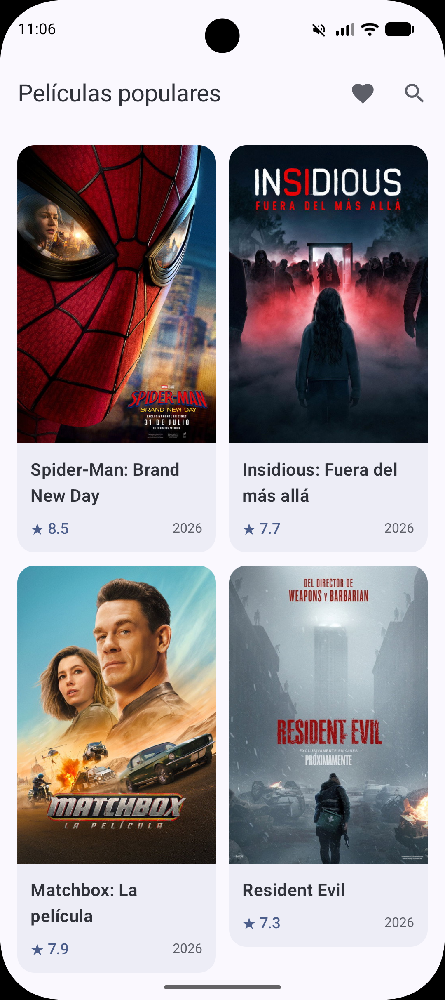
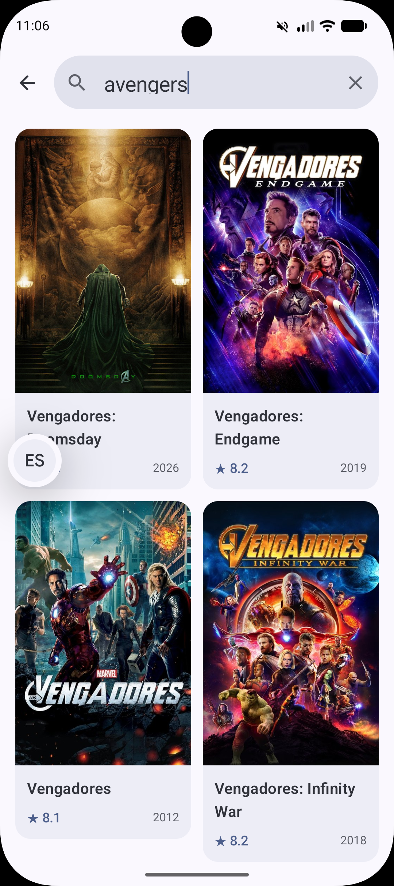
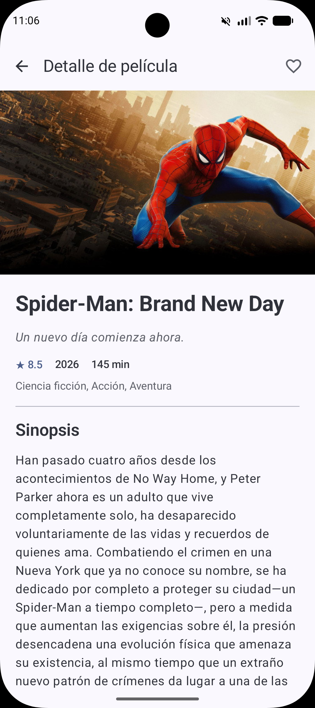
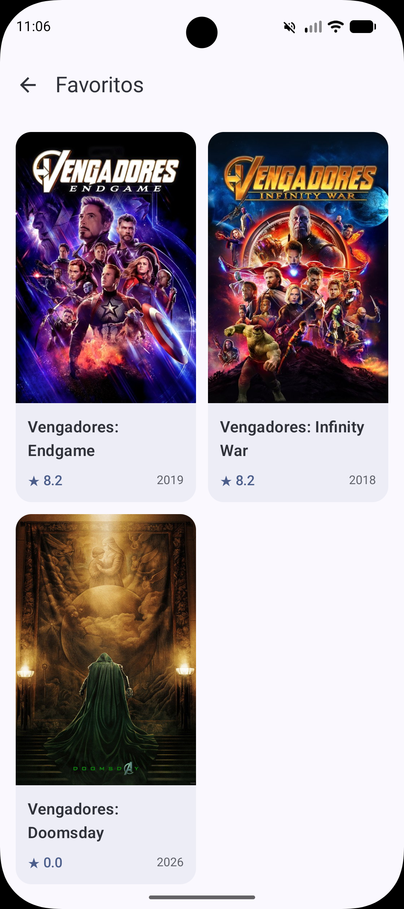
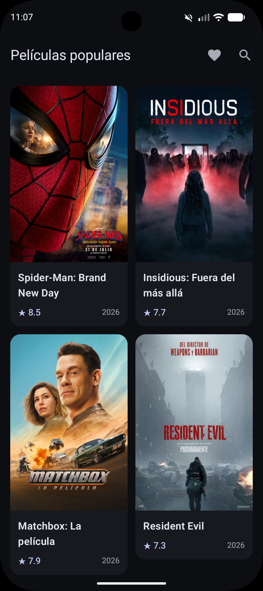
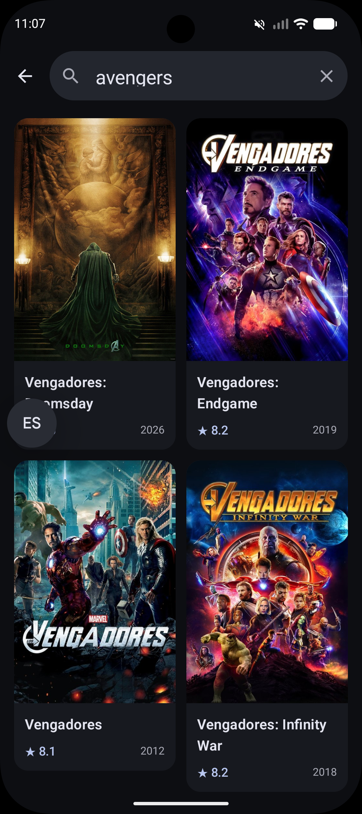
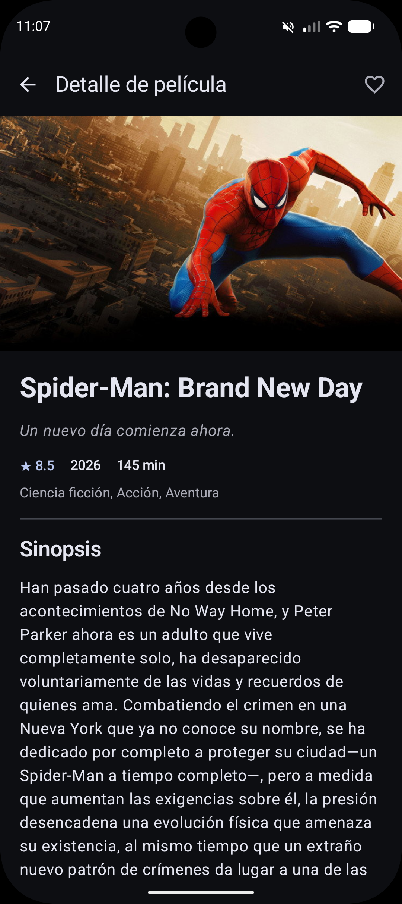
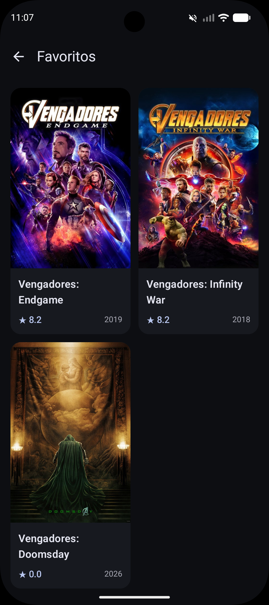
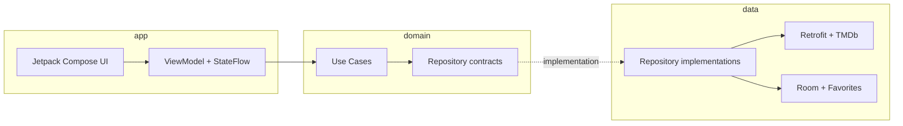

# MoviesChallenge 🎬

[](https://kotlinlang.org)
[](https://developer.android.com/compose)
[](#arquitectura)
[](https://developer.android.com)

**MoviesChallenge** es una aplicación Android de exploración de películas construida con Kotlin y Jetpack Compose. Consume la API de [The Movie Database (TMDb)](https://www.themoviedb.org/), permite consultar películas populares, buscar por título, revisar su detalle y mantener una colección local de favoritos.

El proyecto prioriza separación de responsabilidades, flujo de datos predecible, componentes reutilizables y una estrategia de pruebas que no depende de un dispositivo físico para validar la UI.

---

## Funcionalidades

- Catálogo paginado de películas populares.
- Búsqueda remota por título con debounce de `350 ms`.
- Estados de carga, vacío, error y reintento.
- Detalle de película con imagen, géneros, duración, fecha, calificación y sinopsis.
- Persistencia local de favoritos mediante Room.
- Consulta reactiva del estado favorito desde la pantalla de detalle.
- Navegación tipada entre catálogo, favoritos y detalle.
- Temas claro y oscuro con soporte de colores dinámicos en Android 12 o superior.

## Capturas

### Tema claro

| Catálogo | Búsqueda | Detalle | Favoritos |
| :---: | :---: | :---: | :---: |
|  |  |  |  |

### Tema oscuro

| Catálogo | Búsqueda | Detalle | Favoritos |
| :---: | :---: | :---: | :---: |
|  |  |  |  |

---

## Arquitectura

La aplicación combina **MVVM**, flujo unidireccional de datos y principios de **Clean Architecture**. Las dependencias apuntan hacia el dominio y los detalles de infraestructura permanecen en la capa de datos.



### Módulos

| Módulo | Responsabilidad |
| :--- | :--- |
| `:app` | UI con Compose, ViewModels, navegación, modelos de presentación, tema e inyección de casos de uso. |
| `:domain` | Modelos de negocio, contratos de repositorio, casos de uso y resultados de dominio. Es un módulo JVM sin dependencia de Android. |
| `:data` | Retrofit, OkHttp, PagingSource, Room, DTOs, entidades, mappers e implementaciones de repositorio. |

Dependencias entre módulos:

```text
:app ───────> :domain
  │
  └─────────> :data ───────> :domain
```

### Flujo de datos

1. La UI emite eventos hacia el `ViewModel`.
2. El `ViewModel` ejecuta casos de uso y expone estado mediante `StateFlow` o `PagingData`.
3. Los casos de uso dependen exclusivamente de contratos definidos en `:domain`.
4. `:data` resuelve esos contratos usando TMDb o Room.
5. Los resultados se transforman de DTO/entidad a dominio y finalmente a modelos de UI.

### Organización de presentación

La capa `:app` está organizada por feature:

```text
app/src/main/java/com/jquiroga/movieschallenge/
├── common/ui/          # Composables compartidos
├── core/               # Tema y configuración de aplicación
├── di/                 # Provisión de casos de uso
└── features/
    ├── home/           # Catálogo y búsqueda
    ├── detail/         # Detalle y actualización de favorito
    ├── favorite/       # Colección local de favoritos
    ├── navigation/     # Destinos y NavHost
    └── main/           # Activity principal
```

### Organización de dominio

El módulo `:domain` concentra las reglas y contratos del negocio. No conoce detalles de Android, Retrofit, Room ni de la interfaz de usuario.

```text
domain/src/main/java/com/jquiroga/movieschallenge/domain/
├── model/              # Modelos de negocio: Movie, MovieDetail y Genre
├── repository/         # Contratos para acceder a películas y favoritos
├── result/             # Resultado tipado y errores del dominio
└── usecase/            # Operaciones disponibles para la capa de presentación
    ├── home/           # Obtener el catálogo paginado
    ├── detail/         # Obtener el detalle de una película
    └── favorite/       # Consultar, observar, agregar y eliminar favoritos
```

Sus responsabilidades se distribuyen así:

- `model`: representa la información que utiliza el negocio, independientemente de cómo llegue desde la API o se guarde localmente.
- `repository`: define las interfaces `MovieRepository` y `FavoriteRepository`; sus implementaciones pertenecen a `:data`.
- `result`: modela resultados exitosos y errores esperados mediante `DomainResult` y `DomainError`.
- `usecase`: expone una operación por caso de uso y funciona como punto de entrada desde los `ViewModel`.

Las pruebas unitarias del módulo mantienen una estructura equivalente bajo `domain/src/test`, con cobertura para los casos de uso de catálogo, detalle y favoritos.

### Organización de datos

El módulo `:data` implementa los contratos definidos por `:domain` y decide de qué fuente obtener o persistir la información.

```text
data/src/main/java/com/jquiroga/movieschallenge/data/
├── core/utils/                 # Configuración de API, URLs de imágenes y tiempo
├── datasource/
│   ├── remote/
│   │   ├── api/                # Definición de endpoints de TMDb
│   │   ├── dto/                # Modelos de las respuestas HTTP
│   │   ├── interceptor/        # Inclusión del token de autenticación
│   │   ├── mapper/             # Conversión de DTOs y errores a dominio
│   │   └── source/             # Acceso remoto y PagingSource
│   └── local/
│       ├── dao/                # Consultas de Room
│       ├── db/                 # Configuración de la base de datos
│       ├── entity/             # Modelo persistido de favoritos
│       ├── mapper/             # Conversión entre entidad y dominio
│       └── source/             # Acceso a la fuente local
├── repository/                 # Implementaciones de los contratos de dominio
└── di/                         # Provisión y vinculación de dependencias con Hilt
```

El recorrido de los datos dentro del módulo es:

```text
MovieDataRepository ─────> MovieRemoteDataSource ─────> MovieApi
          │                          │
          └── modelos de dominio <── DTO + mapper

FavoriteDataRepository ──> FavoriteLocalDataSource ──> FavoriteMovieDao
          │                          │
          └── modelos de dominio <── Entity + mapper
```

- La fuente remota encapsula Retrofit y utiliza `MoviePagingSource` para cargar el catálogo y las búsquedas por páginas.
- La fuente local encapsula Room y expone los favoritos como un flujo observable.
- Los mappers impiden que los DTOs y las entidades de persistencia se filtren hacia `:domain` o `:app`.
- Los repositorios coordinan las fuentes y entregan exclusivamente modelos y resultados definidos por el dominio.
- Los módulos de Hilt construyen Retrofit, Room y sus dependencias, y enlazan cada contrato con su implementación.

---

## Stack tecnológico

| Tecnología | Versión | Uso |
| :--- | :--- | :--- |
| Kotlin | 2.2.10 | Lenguaje principal. |
| Android Gradle Plugin | 9.2.1 | Build del proyecto Android. |
| Gradle | 9.4.1 | Automatización del build. |
| Jetpack Compose BOM | 2026.02.01 | UI declarativa y Material 3. |
| Navigation 3 | 1.2.0 | Navegación tipada basada en `NavKey`. |
| Lifecycle | 2.11.0 | ViewModel y recolección lifecycle-aware. |
| Paging 3 | 3.5.3 | Paginación del catálogo y resultados de búsqueda. |
| Hilt | 2.60.1 | Inyección de dependencias. |
| Retrofit | 3.0.0 | Cliente HTTP declarativo. |
| OkHttp | 4.12.0 | Transporte HTTP, autenticación y logging de debug. |
| Kotlinx Serialization | 1.9.0 | Serialización de respuestas JSON. |
| Room | 2.8.5 | Persistencia de favoritos. |
| Coil | 3.4.0 | Carga de pósteres y backdrops. |
| Coroutines | 1.10.2 | Concurrencia y flujos asíncronos. |
| Robolectric | 4.17 | Ejecución local de pruebas de UI Compose. |
| Roborazzi | 1.76.0 | Screenshot testing en JVM. |
| MockK | 1.14.11 | Test doubles en pruebas unitarias. |

---

## Cómo ejecutar el proyecto

### Requisitos

- Android Studio compatible con AGP `9.2.1`.
- JDK `21` para el daemon de Gradle.
- Android SDK `37` instalado.
- Un dispositivo o emulador con Android 7.0 (API 24) o superior.
- Conexión a Internet para consultar TMDb.

### Pasos

1. Clonar el repositorio:

   ```bash
   git clone https://github.com/jamerquiroga/MoviesChallenge.git
   cd MoviesChallenge
   ```

2. Abrir el proyecto en Android Studio y sincronizar Gradle.

3. Seleccionar la configuración `app` y ejecutar en un dispositivo o emulador.

También se puede generar el APK de debug desde terminal:

```bash
./gradlew :app:assembleDebug
```

### Configuración de TMDb

Para facilitar la evaluación del reto, el repositorio incluye un token de demostración en `ApiConfig`. En un proyecto productivo este valor debe inyectarse desde una fuente no versionada —por ejemplo, `local.properties`, variables de entorno o un servicio seguro— y nunca almacenarse directamente en el código fuente.

La aplicación utiliza el idioma `es-PE` y consume:

| Endpoint | Descripción |
| :--- | :--- |
| `GET /movie/popular` | Catálogo de películas populares. |
| `GET /search/movie` | Búsqueda paginada por título. |
| `GET /movie/{movie_id}` | Información detallada de una película. |

---

## Pruebas

La estrategia cubre lógica de dominio, estado de presentación, comportamiento de componentes Compose y regresiones visuales.

| Nivel | Herramientas | Cobertura actual |
| :--- | :--- | :--- |
| Dominio | JUnit, Coroutines Test y MockK | Casos de uso de catálogo, detalle y favoritos. |
| Presentación | JUnit, Coroutines Test y MockK | Estados del `FavoritesViewModel`. |
| UI Compose | Compose UI Test + Robolectric | Contenido y semántica clickable de `MovieCard`. |
| Screenshot | Roborazzi + Robolectric Native Graphics | `MovieCard` en temas claro y oscuro. |

Ejecutar todas las pruebas unitarias:

```bash
./gradlew test
```

Ejecutar las pruebas JVM del módulo `app`:

```bash
./gradlew :app:testDebugUnitTest
```

Verificar los screenshots contra sus goldens:

```bash
./gradlew :app:verifyRoborazziDebug
```

Actualizar los goldens cuando el cambio visual sea intencional:

```bash
./gradlew :app:recordRoborazziDebug
```

Los goldens versionados se encuentran en `app/src/test/screenshots`. Las pruebas Compose usan Robolectric con API 35 para mantener compatibilidad estable con la JVM actual; esto no modifica el `compileSdk` ni el `targetSdk` de la aplicación.

---

## Decisiones técnicas

### 1. Clean Architecture modular

**Decisión:** separar presentación, dominio y datos en `:app`, `:domain` y `:data`.

**Motivación:** aislar reglas de negocio, facilitar pruebas JVM y permitir que las fuentes de datos cambien sin afectar a la UI.

**Trade-off:** para un proyecto pequeño aumenta la cantidad de mappers, módulos y configuración de inyección de dependencias.

### 2. MVVM y estado inmutable

**Decisión:** los ViewModels exponen `StateFlow` y estados sellados; la UI envía eventos y renderiza el estado recibido.

**Motivación:** mantener un flujo unidireccional, observable y fácil de probar, evitando que los composables contengan lógica de negocio.

### 3. Paging 3 para catálogo y búsqueda

**Decisión:** utilizar un único `MoviePagingSource` parametrizado por la consulta.

**Motivación:** unificar catálogo y búsqueda, manejar carga incremental y representar correctamente errores de refresh y append. La búsqueda aplica debounce y `flatMapLatest` para cancelar consultas obsoletas.

**Trade-off:** el catálogo depende de la red; actualmente no existe caché offline ni `RemoteMediator`.

### 4. Contratos en dominio y errores tipados

**Decisión:** definir interfaces de repositorio y `DomainResult` en `:domain`.

**Motivación:** evitar que excepciones HTTP o de almacenamiento lleguen directamente a presentación. Las cancelaciones de coroutines se relanzan para preservar la concurrencia estructurada.

### 5. Room únicamente para favoritos

**Decisión:** persistir localmente la película completa junto con la fecha en que fue guardada.

**Motivación:** permitir que favoritos sobreviva a reinicios y pueda mostrarse sin volver a consultar cada detalle. La fecha de guardado mantiene el orden más reciente primero.

### 6. Navigation 3 con destinos tipados

**Decisión:** representar destinos mediante implementaciones serializables de `NavKey`.

**Motivación:** evitar rutas construidas como strings y transportar el identificador de película de forma tipada.

### 7. Hilt y assisted injection en detalle

**Decisión:** usar Hilt para resolver repositorios y casos de uso, y assisted injection para entregar `movieId` al `MovieDetailViewModel`.

**Motivación:** mantener dependencias explícitas sin acoplar el ViewModel al mecanismo de navegación.

### 8. Componentes compartidos desacoplados de cada feature

**Decisión:** ubicar componentes reutilizables en `common/ui` y pasar datos visuales primitivos en lugar de modelos pertenecientes a Home o Favoritos.

**Motivación:** evitar dependencias entre features. `MovieCard` conserva una única implementación y hace opcional el callback para representar correctamente tarjetas interactivas y estáticas.

### 9. Pruebas de UI locales y screenshots deterministas

**Decisión:** ejecutar Compose UI Test con Robolectric y regresiones visuales con Roborazzi.

**Motivación:** obtener feedback rápido sin depender de un dispositivo. Los screenshots fijan tema, dimensiones, SDK y datos; además evitan imágenes de red para reducir flakiness.

**Trade-off:** Robolectric no reemplaza por completo pruebas end-to-end en un dispositivo real y los goldens pueden variar entre sistemas operativos si el entorno de generación no está controlado.

---

Desarrollado por [Jamer Quiroga](https://github.com/jamerquiroga).
